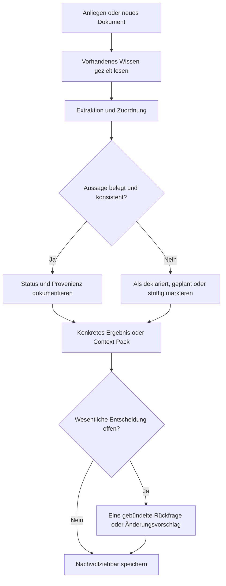

# Business-DNA – Conceptual Architecture & Organizational Knowledge Specification v0.1

**Status:** Concept / implementierbarer Starter-Contract · **Stand:** 27. Oktober 2026  
**Komponente:** `business-dna/` · **Kompatibilität:** eigenständig und optional in der Agentic Marketing Suite  
**Ziel:** Das Wissen einer Organisation so strukturieren, prüfen, fortschreiben und für KI bereitstellen, dass verschiedene Systeme **konsistent, zweckbezogen und nachvollziehbar** damit arbeiten können.

> **Leitidee:** Das Unternehmen muss seine Identität nicht jedem KI-System neu erklären. Business-DNA verwandelt vorhandene, belegbare Unternehmensinformationen in eine lebendige, versionierte Wissensgrundlage – ohne den Menschen durch einen endlosen Fragebogen zu führen.

## 0. Executive Summary

Business-DNA ist **ein eigenständiger fachlicher KI-Spezialist** und **ein optionaler gemeinsamer Wissenslieferant**. Er versteht Unternehmen, ermittelt fehlende Informationen durch Analyse bestehender Unterlagen, unterscheidet Tatsachen, Selbstbeschreibungen, Vorhaben und Hypothesen, führt Herkunftsnachweise und liefert anderen Spezialisten nur den jeweils relevanten Kontext.

Business-DNA ist **kein** CRM, keine vollumfängliche ERP-/DMS-Anwendung, kein eigener Agenten-Harness, keine zwingende zentrale Datenbank und kein automatischer Wahrheitsrichter. Das System darf Unternehmensrealität **nicht** mit Marketingversprechen, Aspirationsprofilen oder LLM-Schlussfolgerungen verwechseln.

**Minimalbetrieb:** `AGENT.md` + `.business-dna/` mit Methoden + `input/` + `archiv/`. Fachliche Ergebnisordner, zusätzliche Indexe und maschinenlesbare Bestände entstehen nur nach Bedarf. Alle Daten bleiben in portablen Textformaten. Business-DNA muss ohne weitere Module arbeitsfähig sein; jedes andere Suite-Modul muss ebenso ohne Business-DNA arbeitsfähig bleiben.

## 1. Ziele und Nicht-Ziele

### 1.1 Ziele

1. Identität, Produkte, Geschäftsmodell, Ziele, Kompetenzen, Ressourcen, Prozesse und wesentliche Entscheidungen einer Organisation nachvollziehbar abbilden.
2. Jede wichtige Aussage als **atomare Claim-Einheit** mit Status, Herkunft, Zeitbezug und Verwendungsgrenze modellieren.
3. Unterschiedliche Quellen automatisch analysieren, Widersprüche aufzeigen und dem Menschen **nur wesentliche Entscheidungsfragen** vorlegen.
4. Für konkrete Aufgaben kleine, belastbare **Context Packs** bereitstellen – kein ungezieltes Volltext-Dumping aller Unterlagen in jedes LLM.
5. Geprüfte Aussagen, deklarierte Selbstauskünfte, geplante Fähigkeiten und Hypothesen unmissverständlich unterscheiden.
6. Änderungen versionieren, Entscheidungen festhalten, Provenienz bewahren und fachliche Korrekturen systematisch ermöglichen.
7. Offene Schnittstellen zu Marketing, Branding, Website, PR, Creative, noCRM, Analytics und externen KI-Umgebungen anbieten.
8. DSGVO-relevante Informationen datensparsam behandeln und Zugriffe entsprechend den Möglichkeiten des ausführenden Systems kontrollieren.

### 1.2 Nicht-Ziele

- Kein universeller Datensammler oder Überwachungssystem für Beschäftigte und Kontakte.
- Keine automatische Erstellung eines „offiziell verifizierten“ Firmenprofils ohne geeignete Belege.
- Kein zwingender Graphserver, Vektorspeicher oder Fine-Tuning eines Sprachmodells.
- Keine Pflicht, zu jedem Unternehmensmerkmal persönliche Angaben oder Interviews einzuholen.
- Keine automatische Übernahme aller E-Mails, noCRM-Verläufe, privaten Dateien oder fremden Mandantendaten.
- Keine operative Unternehmenssteuerung und keine neue Hierarchie über den Fachspezialisten.
- Keine verpflichtende Browser-Oberfläche, kein eigener Harness, keine Aufgabenscheduler-Engine.

## 2. Selbstverständnis und Fachliche Rolle

Business-DNA agiert als qualifizierter **Organizational Knowledge Advisor**. Er analysiert, berät, fasst zusammen, erkennt Lücken, schlägt Änderungen vor, erstellt Wissensartefakte und beantwortet konkrete fachliche Fragen. „Wobei kann ich Ihnen beim Unternehmenswissen helfen?“ ist die einzige Einstiegsfrage, wenn beim Start **kein** Auftrag vorliegt.

Liegt ein Auftrag vor, liefert der Spezialist direkt ein sinnvolles Zwischenergebnis. Er stellt nur **blockierende** Rückfragen, z. B. um zwei widersprüchliche Eigentümerangaben rechtsverbindlich zuzuordnen. Eine bestehende Dokumentation wird **nicht** allein deshalb als wahr eingestuft, weil sie ausführlich ist.

Das System denkt als Prüfer, nicht als Copywriter: Es soll bei einer Behauptung wie „Marktführer in Europa“ Nachweise anfordern oder die Aussage zurückstufen, statt einen Marketingtext daraus zu machen.

## 3. Architekturprinzipien

| Prinzip | Verbindliche Konsequenz |
|---|---|
| Autonomie | `business-dna/AGENT.md` ist separat startbar. Keine Suite als technische Voraussetzung. |
| Offene Daten | Markdown für menschliches Wissen; JSON/JSONL für atomare Aussagen, Provenienz und Austausch. |
| Knapper Kern | Methoden und Regeln in `.business-dna/`; Ergebnisse außerhalb, dynamisch. |
| Source first | Relevante Aussagen benötigen dokumentierten Ursprungs- oder Entscheidungsbezug. |
| Keine stille Aufwertung | Ein Plan darf nicht ohne neue Evidenz zu einer bestätigten Funktion werden. |
| Kein verdecktes Überschreiben | Fachliche Änderungsvorschläge werden nachvollziehbar übernommen oder zurückgewiesen. |
| Relevanz vor Vollständigkeit | Context Packs werden für ein konkretes Thema und einen Verwendungszweck zusammengestellt. |
| Fachzuständigkeit | Branding definiert gewünschte Markenpositionierung; Business-DNA dokumentiert belegbare Unternehmensfakten. |
| Kleine Integration | Bestehende Harness-Funktionen lesen/schreiben Dateien und rufen optionale Tools auf; Business-DNA enthält keinen eigenen Harness. |
| Auditierbarkeit | Wer/was/wann/warum und Quellen zu jeder entscheidungsrelevanten Änderung. |

## 4. Grundstruktur

```text
business-dna/
├── AGENT.md                         # natürlicher Einstieg / Beratungsauftrag
├── .business-dna/
│   ├── BERATUNG.md                   # Beratungsverhalten
│   ├── RULES.md                     # epistemische und operative Leitplanken
│   ├── ARCHITECTURE.md              # Domänenmodell, Abläufe
│   ├── STRUKTUR.md                   # Dateiordnung und Migration
│   ├── METHODEN.md                   # Index und Auswahl
│   ├── DATENMODELL.md               # Claims, Quellen, Ereignisse, Entscheidungen
│   ├── PROVENIENZ.md                 # Nachweise, Status, Konflikte
│   ├── KONTEXT.md                    # Auswahl und Ausgabe von Context Packs
│   ├── INTEGRATION.md                # Modulübergaben, kein Zentralzwang
│   ├── QUALITAET.md                  # Gates und Prüfkriterien
│   ├── STATE.md                     # gegenwärtiger Arbeitsstand
│   ├── LOG.md                       # tatsächlich ausgeführte Operationen
│   ├── HISTORY.md                   # wesentliche bestätigte Entscheidungen
│   ├── TESTFAELLE.md                # Szenarien für den Harness
│   ├── methoden/                    # anwendbare Fachmethoden
│   ├── schemas/                     # offene JSON-Schemas
│   ├── tools/                       # kleine optionale CLI-Hilfen
│   └── beispiele/                   # rein fiktive oder klar deklarierte Tests
├── input/                           # temporäre Eingänge
└── archiv/                          # Originale und Versionen nach Bedarf
```

Die folgenden Ergebnisordner sind **nicht Teil der Pflichtinstallation**; sie entstehen beispielsweise nach einer tatsächlichen Erhebung:

```text
business-dna/
├── unternehmen/                     # ORGANISATION.md, STRATEGIE.md …
├── angebote/                         # produktbezogene Fakten / Entwicklungsstände
├── wissen/
│   ├── claims.jsonl                 # maschinenlesbare atomare Aussagen
│   ├── sources.jsonl                # Quellendatensätze / Nachweise
│   ├── decisions.jsonl              # Beschluss- und Freigabedaten
│   └── events.jsonl                 # fachliche Wissensänderungen
├── kontext/                          # exportierte, zweckgebundene Context Packs
└── ...
```

**Trennregel:** In `.business-dna/methoden/` stehen Verfahren, nicht die Unternehmensdaten. Systemzustände (`STATE`, `LOG`, `HISTORY`) sind keine Ersatzdatenbank für Unternehmensfakten. `archiv/` bewahrt nachvollziehbare ursprüngliche Eingaben und frühere Versionen auf, `input/` bleibt nach erfolgreicher Übernahme leer.

## 5. Domänenmodell

### 5.1 Organisationseinheit (Organization / Unit)

Repräsentiert Unternehmen, Körperschaft, Initiative, Marke oder organisatorische Einheit mit stabiler `org_id`. Die Ausgangsversion behandelt **eine** primäre Organisation, optionale Teilbereiche werden erst nach Bedarf modelliert. Keine Agentur- oder Mandantenverwaltung als Pflicht.

### 5.2 Aussage (Claim)

Die kleinste semantisch bedeutungsvolle Einheit ist **eine überprüfbare oder ausdrücklich als subjektiv erkennbare Aussage**:

```
subject + predicate + value + status + source_refs + time + visibility + version
```

Beispiel: `topaca:cognitive-computer` / `product_stage` / `development` / `declared` – nicht `verified`, solange keine geeigneten Nachweise geprüft sind.

Ein Claim besitzt eine stabile ID, kann zeitlich überholt werden und bleibt über Events nachvollziehbar. Ein Dokument kann viele Claims zusammenfassen. Eine Aussage kann aus mehreren Quellen stammen, aber eine Quellenliste allein garantiert keine Richtigkeit.

### 5.3 Quelle (Source)

Quellenarten: `official_register`, `primary_document`, `technical_test`, `audited_record`, `internal_record`, `human_statement`, `external_publication`, `derived_analysis`. Zu speichern sind `source_id`, Typ, konkrete Fundstelle, Erfassungszeit, optional Hash/Version, Verantwortlichkeit und Zugangsklasse. Der Quellenverweis muss überprüfbar bleiben. Bloße LLM-Ausgaben ohne belegte Ursprungstexte sind **keine Primärquellen**.

### 5.4 Entscheidung (Decision)

Unternehmensziele, Freigaben, Policy-Ausnahmen, Prioritäten und Änderungen erfordern gegebenenfalls eine verantwortliche menschliche Entscheidung. Die Entscheidung ist getrennt von behaupteten Fakten, mit Entscheidungsgegenstand, Identität/Vertretungsrolle, Zeitpunkt und betroffenen Claim-IDs. Ein KI-Vorschlag ist kein Beschluss.

### 5.5 Ereignis (Event)

Append-only protokolliert `claim.created`, `claim.revised`, `claim.disputed`, `claim.superseded`, `context.exported`, `decision.recorded`, `source.rechecked`, `deletion.applied`. Ein Event verweist nach Möglichkeit auf den Ausgangs- und Zielzustand; ein System `LOG.md` beschreibt dagegen betriebliche Datei- und Toolaktionen.

### 5.6 Context Pack

Ein zeitbezogener, zweckgebundener Export passender Claims, kenntlich nach Status und Quellen. Er ist ein **Snapshot**, kein neues Originalwissen. Die Weitergabe kann Markdown und JSON umfassen. Ein zweites System darf den Status nicht stillschweigend als „bestätigt“ uminterpretieren.

## 6. Epistemisches Zustandsmodell

| Status | Bedeutung | Kommunikation |
|---|---|---|
| `verified` | Mit geeigneter Evidenz für die konkrete Aussage geprüft | Als geprüfte Tatsache, innerhalb der Nachweisgrenzen |
| `declared` | Als Aussage des Unternehmens erfasst, unabhängig noch nicht geprüft | „Das Unternehmen gibt an …“ |
| `planned` | Beschlossener oder genannter Zukunftsplan | „Geplant / angestrebt …“ |
| `hypothesis` | Analytische Annahme | Als Hypothese, nicht als Produktversprechen |
| `disputed` | Widersprüchliche Hinweise liegen vor | Nicht als gesicherte Aussage verbreiten |
| `superseded` | Durch neuere Aussage / Entscheidung abgelöst | Nur historisch; nicht in aktuellen Standardexports |
| `rejected` | Als falsch oder nicht tragfähig bewertet | Nicht als aktive Aussage weitergeben |
| `unknown` | Benötigte Information noch nicht ermittelt | Wissenslücke ausdrücklich benennen |

**Separat** zu verwalten sind die Reife eines Produkts (`idea`, `design`, `prototype`, `pilot`, `production`) und der Erkenntnisstatus seiner jeweiligen Behauptungen. „Produktdesign vorhanden“ impliziert nicht „marktreif“.

Ein Statuswechsel `declared -> verified` setzt neue passende Quellen und eine nachvollziehbare Prüfung voraus. `planned -> verified` darf nie allein durch Fristablauf erfolgen. `disputed -> verified` setzt eine begründete Konfliktauflösung voraus.

## 7. Quellenhierarchie, Konflikte und Aktualität

Quellen haben **keinen universellen pauschalen Vorrang**. Maßgeblich sind Aussageart, Zuständigkeit, Primärnähe, Datumsbezug und Prüfqualität. Zum Beispiel kann ein Firmenbuchauszug die rechtliche Firma besser belegen als ein Marketingbriefing, eine gültige Vorstandsbeschlussfassung jedoch aktuelle Ziele besser als eine ältere Website. Bei Konflikten speichert Business-DNA beide konkurrierenden Aussagen, verweist auf die Fundstellen und kennzeichnet die Unklarheit.

Aktualitätskontrollen sind domänenspezifisch. Rechtsform/Anschrift, Produktreifegrad, Preis, Teamgröße und strategische Ziele brauchen unterschiedliche Review-Zyklen. Die v0.1 enthält **keine erfundenen globalen TTL-Werte**, sondern eine überprüfbare `review_due_at`-Option.

**Verifikation ist dreistufig:** (1) Existiert die zitierte Quelle? (2) Trägt die Quelle die konkrete Aussage? (3) Ist sie für diesen Geltungsbereich und Zeitpunkt maßgeblich? Ein LLM ist bei dieser Prüfung Hilfsmittel, kein unabhängiger Beweis.

Das Modell orientiert sich konzeptionell an Provenienz-Prinzipien wie **W3C PROV-O** (`Entity`, `Activity`, `Agent`), ohne für den Minimalbetrieb RDF oder einen Graphserver vorauszusetzen: https://www.w3.org/TR/prov-o/.

## 8. Fachliche Inhaltsdomänen

| Domäne | Primäre Inhalte | Typische Herkunft |
|---|---|---|
| Unternehmensidentität | Name, Rechtsform, Standorte, Geschichte, Kerndaten | Register, interne Unterlagen |
| Unternehmensstrategie | Ziele, Mission, Vision, Prioritäten, beschlossene Vorhaben | Beschlüsse und Strategieunterlagen |
| Geschäftsmodell | Angebote, Kundensegmente, Wertschöpfung, Preise soweit bestätigt | Produktunterlagen, Management |
| Produkt- und Leistungsbestand | Funktionen, Reifegrad, Verfügbarkeit, Grenzen, Roadmap | Demos, Tests, Freigaben |
| Ressourcen und Kompetenzen | Know-how, Technologien, Organisation, Kapazitäten | Nachweise, dokumentierte Rollen |
| Prozesse und Regeln | Arbeitsabläufe, Verantwortlichkeiten, Richtlinien | Prozessdokumentation |
| Markt- und Umfeldfakten | Marktdefinition, Regulatorik, Referenzen, externe Fakten | Verifizierte Fremdquellen |
| Entscheidungen und Änderungen | Beschlüsse, gültige Fassungen, Konfliktauflösungen | Autorisierte Entscheidungen |

Eine Brand Persona, ein Claim, ein visuelles Design und eine Kommunikationsstrategie sind **fachliche Arbeitsergebnisse von Branding, Creative oder Marketing**. Business-DNA darf sie referenzieren und gegebenenfalls ihre Gültigkeit/Verabschiedung dokumentieren, aber nicht stillschweigend deren fachliche Zuständigkeit übernehmen.

## 9. Standardablauf



**Kein Onboarding-Zwang:** Schon ein einzelnes Dokument reicht für ein vorläufiges, lückenhaft markiertes Organisationsprofil. Keine künstlichen Pflichtphasen. Kein automatisches Erstellen aller möglichen Ordner. Quellen und geschützte Inhalte werden nur mit entsprechendem Auftrag und geeigneten Zugriffsrechten verarbeitet.

### 9.1 Eingänge

- Direktes Briefing oder Unternehmensfrage.
- Vorhandene Markdown-, PDF-, HTML-, Tabellen- oder andere Dokumente, soweit das Ausführungssystem sie lesen kann.
- Optional interne bestehende Ergebnisse benachbarter Fachmodule.
- Öffentlich zugängliche Quellen nur bei vorhandener Recherchefähigkeit und Zweckbindung.

### 9.2 Beratungsergebnis

Mindestens: nützliche strukturierte Aussage, relevante Unklarheiten, begründete Empfehlung und gegebenenfalls verwendbare Datei. Nur wesentliche offene Entscheidungen werden dem Menschen vorgelegt.

### 9.3 Wissen aktualisieren

Neue Claims werden gegen alte geprüft, veraltete Versionen markiert, Quellen erhalten, Entscheidungen protokolliert und abhängige Context Packs als potentiell überholt gekennzeichnet. Änderungen in fremden Modulen werden zunächst **vorgeschlagen**, nicht eigenmächtig zurückgeschrieben.

## 10. Integration in andere Fachmodule

**Business-DNA ist ein optionales Angebot an Kontext, kein zentraler Agent.** Andere Module entdecken es über relativen Pfad `../business-dna/` oder einen konfigurierten Pfad. Falls nicht vorhanden, arbeiten sie ohne Einschränkung mit ihren eigenen Unterlagen.

| Konsument | Typischer Context Pack | Abgrenzung |
|---|---|---|
| `marketing/` | Angebote, Geschäftsmodell, Ziele, Ressourcen | Definiert weiterhin Marketingstrategie |
| `branding/` (optional) | Identität, Werte, Geschichte, beschlossene Richtung | Definiert Markenpositionierung und Markensystem |
| `creative/` | Identität, belegte Produkteigenschaften, gültige Designreferenzen | Produziert Gestaltung |
| `pr/` | Verifizierte Fakten, Personenrollen nur zweckzulässig, Meilensteine | Beurteilt Nachrichtenwert |
| `advertising/` | Belastbare Leistungsbelege, Verfügbarkeit und Ausschlüsse | Entwickelt und bucht Werbemittel nach Freigaben |
| `website/` | Unternehmensangaben, Produkte, ggf. rechtliche Stammdaten | noCMS pflegt Website und Veröffentlichungen |
| `social-media/` | Ziel, Fakten, Produktreifegrad | Plant kanalangemessene Inhalte |
| `noCRM/` | Freigegebene Produktfakten, korrekte Ansprechpartnerrollen | Individuelle Kontakthistorien bleiben im noCRM |
| `analytics/` | Zieldefinitionen, zeitliche Veränderungen, Maßnahmengeschichte | Bewertet tatsächliche Wirkung |

**Kein implizites Mandat:** Ein Konsument erhält nicht automatisch alle personenbezogenen, internen oder vertraulichen Daten. Business-DNA erzeugt eine bedarfsgerechte Auswahl auf Grundlage zugelassener Sichtbarkeit. Eine automatisierte Zugriffskontrolle ist nicht Teil des Dokumentmodells und muss beim tatsächlich ausführenden System liegen.

## 11. Context-Pack-Protokoll v0.1

Die optionale maschinenlesbare Anfrage enthält:

```json
{
  "request_id": "req-example-001",
  "requester": "advertising",
  "purpose": "Claims für Produktkampagne auf ihre Belegbarkeit prüfen",
  "topics": ["product", "capability", "availability"],
  "max_characters": 6000,
  "visibility_max": "shared",
  "as_of": "2026-10-27"
}
```

Response-Invarianten:

- Enthält `request_id`, `generated_at`, `sources`, Liste der ausgewählten Claims, `excluded_count`, `limitations` und Snapshot-Version, soweit verfügbar.
- Jeder Claim trägt ID, Status, Geltung, Provenienzverweise sowie gegebenenfalls Aktualitätshinweise.
- `planned`, `declared` und `hypothesis` werden **nicht** in gesicherte Fakten umetikettiert.
- Standardmäßig nur aktive `verified`, `declared` oder `planned` innerhalb erlaubter Sichtbarkeit. Strittige Claims werden nur bei ausdrücklich angeforderter Konfliktprüfung einbezogen.
- Insbesondere keine vertraulichen oder personenbezogenen Daten in `public`-Exports. Ein technischer Prüfer unterstützt die Filterung, ersetzt aber keine Autorisierung.
- Die Response ist **kein** Auftrag zur Änderung der Datenbestände eines empfangenden Moduls.

## 12. Datenmodell und Verträge

Die Referenz-Schemas liegen in `.business-dna/schemas/`:

| Schema | Aufgabe |
|---|---|
| `claim.schema.json` | Atomare Aussage mit Status, Provenienz, Version, Sichtbarkeit |
| `source.schema.json` | Quelle und überprüfbare Fundstelle |
| `decision.schema.json` | Verantwortliche Entscheidung, Referenzen, Zeitpunkt |
| `event.schema.json` | Nachvollziehbare Änderung einer Wissenseinheit |
| `context-request.schema.json` | Zweckgebundene Wissensabfrage |
| `context-pack.schema.json` | Ergebnis-Snapshot für andere Systeme |

Der einfache Betrieb arbeitet mit UTF-8-`*.md`, `*.json`, `*.jsonl`. JSONL enthält **ein Objekt je Zeile**. IDs sind stabil; **`wissen/claims.jsonl` führt v0.1 als aktuellen Snapshot je Claim-ID genau eine aktive/historisch markierte Fassung**. Frühere Fassungen werden im Archiv aufbewahrt und durch Events referenziert. Änderungen dürfen die Herkunftskette nicht rückwirkend auslöschen. Ein separates Konvertierungsverfahren kann bei Bedarf RDF/PROV-O, JSON-LD oder andere Formate erzeugen, ohne sie als Laufzeitpflicht zu etablieren.

## 13. Versionierung, Entscheidungen, Audit

- `STATE.md`: aktueller Arbeitsauftrag, offene Lücken, nächste fachliche Schritte.
- `LOG.md`: tatsächliche Dateien/Tools/Exporte/Prüfungen, Zeit und Ergebnis; keine fingierten Einträge.
- `HISTORY.md`: bestätigte strategisch relevante Richtungsentscheidungen; nicht jede Tippkorrektur.
- `wissen/events.jsonl`: konkrete Claims mit Erzeugung, Revision, Supersession und Begründung.
- `wissen/decisions.jsonl`: vom berechtigten Menschen tatsächlich bestätigte Entscheidungen.
- `archiv/`: unveränderte Eingaben und ältere freigegebene Versionen, soweit erforderlich.

Ein KI-Vorschlag wird nie durch bloßes Aufschreiben zur bestätigten menschlichen Entscheidung. Ein fehlender Freigabenachweis ist zu benennen. Eine einmal ausgeteilte Pack-Version wird nicht nachträglich „umgeschrieben“; neue Packs erhalten einen neuen Erstellungszeitpunkt bzw. eine neue Kennung. Der v0.1-CLI-Exporter liest den **jeweils aktuellen Snapshot**; `as_of` verhindert, dass künftig gültige Einträge aufgenommen werden, rekonstruiert aber **keinen historischen Vollbestand**. Dafür sind archivierte Snapshots erforderlich.

## 14. Datenschutz, Vertraulichkeit und Veröffentlichung

**Grundsatz:** Minimierung, Zweckbindung, Zugriff nach Bedarf. Persönliche Chatverläufe, private Korrespondenz und CRM-Einzelkontakte werden nicht pauschal eingesammelt. Kein automatisches Publizieren des `business-dna/`-Ordners in ein öffentliches Repository. `input/` und `wissen/` können Geschäftsgeheimnisse und personenbezogene Daten enthalten; die Installation muss lokale `.gitignore`-Regeln und eine fachliche Exportfreigabe berücksichtigen.

Zu unterscheiden sind `visibility: public | shared | restricted` und tatsächliche Autorisierung. Ein Feld `public` ersetzt **nicht** die menschliche Veröffentlichungsfreigabe. Exporte müssen zweck- und empfängerbezogen erfolgen. Lösch- und Berichtigungsanforderungen müssen im tatsächlichen Dateibestand und allen dafür verantworteten Kopien umgesetzt werden; ein unveränderliches Auditjournal darf keine dauerhafte Aufbewahrung personenbezogener Inhalte erzwingen.

Diese Spezifikation definiert fachliche Leitplanken, keine vollständige Datenschutz- oder Security-Implementierung. Externe Systeme, Harness und Speicherumgebung bleiben für technisch wirksame Zugriffskontrollen zuständig.

## 15. Qualitätssicherung

**Invarianten:**

1. Kein `verified` ohne eine geeignete, identifizierbare Quelle und passende fachliche Prüfung.
2. Keine aktive Aussage mit zugleich widersprechender freigegebener Aussage ohne erfassten Konflikt.
3. Kein Übergang `planned → verified` allein durch Zeitablauf.
4. Kein Austausch von `source_refs` gegen bloße Agenteninterpretationen.
5. Keine unbemerkte Übernahme eines nicht belegten Werbeclaims als Unternehmensfakt.
6. Kein `public`-Export mit `restricted`-Daten.
7. Kein automatisches Ausrollen in andere Fachmodule nach Änderung ohne dokumentierte Übergabe.
8. Keine fiktiven Erfolgsmeldungen über nicht durchgeführte Prüfungen.
9. Keine Verwechslung von Organisation, Produkt, Marke, Person, Angebot und Ziel.
10. Aktuelle Claims behalten ihr `updated_at` und gegebenenfalls `review_due_at`.

**Prüfstufen:** Schema/Lint → belegbezogene Plausibilitätsprüfung → Konfliktprüfung → Datensparsamkeit → menschliche Entscheidung bei entscheidungsrelevanten, nicht auflösbaren Punkten. Kein pauschales menschliches Abzeichnen jeder Kleinigkeit.

## 16. Fachmethodenbibliothek

Die initiale Bibliothek umfasst **36 konkret benannte Methoden** in acht Bereichen. Die KI findet sie über `METHODEN.md` und öffnet nur die zu einem Auftrag passenden Verfahren. Jede Methode umfasst Auslöser, Inputs, Arbeitsschritte, Qualitätsprüfung, Ergebnis, Grenzen sowie passende Anschlussmethoden.

- `erfassung/` (5): inkrementelles Onboarding, Dokumentenaufnahme, Extraktion, Wissenslücken, Verifikation im Dialog.
- `identitaet/` (4): Stammdaten, Geschichte, Organisation, Rollen/Standorte.
- `strategie/` (5): Ziele, Geschäftsmodell, Roadmap, Ressourcen, Entscheidungsregister.
- `angebote/` (4): Angebotskatalog, Produktreife, Nutzenbeleg, Terminologie.
- `evidenz/` (5): Quellenprüfung, Konflikte, Evidenzstufen, Aktualität, Unsicherheit.
- `governance/` (4): Änderungsanträge, kontrollierte Übernahme, Versionierung, Pflegezyklen.
- `kontext/` (5): Themenpakete, Modulexport, Public Factsheet, Marketingabgleich, Empfängerkontext.
- `qualitaet/` (4): Vollständigkeit, Traceability, Prüfgates, Drift.

## 17. Optionale CLI-Hilfen

Die v0.1 liefert zwei kleine **werkzeugneutrale Python-Programme** (Standardbibliothek; kein Netzwerk; kein eigener Agentendienst):

- `tools/lint_records.py`: prüft JSONL-Format, IDs, Quellenreferenzen, Versionsfelder, Mindestanforderungen an Status `verified`, Zeitstempel und Referenzkonsistenz.
- `tools/build_context.py`: erzeugt aus vorhandenen Claims und Quellen ein begrenztes JSON-Context-Pack für ein Thema, einen Auftrag und eine Sichtbarkeit.

Diese Werkzeuge sind **Referenzprüfungen**, keine juristische oder inhaltliche Richtigkeitsgarantie und keine vollständige Zugriffsschutzschicht. Die Agenten führen sie bei verfügbarem Harness aus.

## 18. Praxisbeispiel TOPACA

Drei illustrative Claims aus dem bereits im Projekt formulierten Briefing:

- `org:topaca / product / Cognitive Computer`: `declared` (Aussage der Projektverantwortlichen).
- `product:cognitive-computer / stage / development`: `declared`.
- `product:cognitive-computer / supports_production_use / true`: **nicht** enthalten; dem Briefing zufolge liegen noch keine demonstrierbaren praktischen Anwendungen vor.

Die Produktvision (Personal AI bis Enterprise AI) ist `planned` bzw. deklarierte Zielrichtung, keine nachgewiesene Lieferfähigkeit. Ein Export an `advertising/` darf die Vision nicht als gegenwärtiges Leistungsversprechen formulieren. Ein Export an `branding/` darf dieselben Angaben für eine Vision nutzen, wenn ihr Status deutlich bleibt.

Das Beispiel ist **keine neue aktuelle Validierung** des Produktstands. Es demonstriert die Trennung von bestätigten Aussagen, Selbstauskünften und Plänen.

## 19. Schnittstelle zur Agentic Marketing Suite

Minimalintegration (nicht verpflichtend): Das Root-`AGENT.md` und `.suite/MODULES.md` können `business-dna/AGENT.md` und die angebotenen Kontextformate listen. Die Module müssen dafür **nicht** umgeschrieben werden. In einer späteren Version können einzelne Spezialisten bei Bedarf relative Context-Pack-Anfragen stellen, ohne eine eigene Runtime-Konvention oder einen zentralen Broker vorauszusetzen.

Der Business-DNA-Ordner darf außerhalb der Suite liegen und über einen konfigurierten Dateipfad referenziert werden. Das ermöglicht Nutzung in Produktion, Forschung, Personalwesen oder anderen organisatorischen Bereichen.

## 20. Reifegrad, Umsetzung und Meilensteine

| Phase | Lieferumfang | Akzeptanz |
|---|---|---|
| **0 – Fachliches Fundament** | Diese Spezifikation, AGENT, Methoden, Schemas, Beispiel | Sofortstart, Statusmodell und Datenabgrenzungen dokumentiert |
| **1 – Minimaler Datenbestand** | Erste geprüfte Claims, Quellenindex, Revisionen, Kontextpakete | Inkrementell erfassbar; keine erfundenen Belege |
| **2 – Fachübergreifende Verwendung** | Übergaben an Marketing, Branding, noCMS etc. | Empfänger sehen Quellen/Status; ohne Business-DNA bleibt alles nutzbar |
| **3 – Kontinuierliche Pflege** | Change-Proposals, Conflict Review, Gültigkeitswarnungen, Import/Export | Änderungen reproduzierbar, nachvollziehbar, bei Bedarf human bestätigt |

**Nicht Bestandteil des v0.1-Umfangs:** Graphdatenbank, automatische RAG-Pipeline, serverseitige Authentifizierung, Cloud-Synchronisation, automatische Unternehmensrecherche oder eigenes Sprachmodell. Diese können optional und später ergänzt werden, ohne das kanonische Claim-Modell zu ersetzen.

## 21. Akzeptanzkriterien v0.1

1. Einlesen von `AGENT.md` ohne Auftrag führt nur zu „Wobei kann ich Ihnen beim Unternehmenswissen helfen?“
2. Bestehender Auftrag wird unmittelbar bearbeitet; keine obligatorische Interviewserie.
3. Ein Dokument mit gemischten Fakten und Plänen wird korrekt in Statusklassen zerlegt.
4. Ohne Beleg wird keine objektive Leistungsbehauptung zu `verified` hochgestuft.
5. Gegensätzliche Angaben erzeugen einen Konflikt und keine stille Überschreibung.
6. Eine neue Fassung erhält dokumentierten Ursprung und Version.
7. Externe Personal-/Kontaktinformationen werden nicht unbegründet in das Unternehmensprofil importiert.
8. Ein Auftrag für `advertising/` erhält nur thematisch relevante, statusgetreue Aussagen.
9. Fehlt Business-DNA, arbeitet `marketing/` ohne Fehler mit eigenen Unterlagen weiter.
10. Die mitgelieferten JSONL- und Context-Pack-Beispiele bestehen die schematischen Tests.
11. `input/`-Originale bleiben bis zur nachweislich erfolgreichen Übernahme erhalten.
12. Keine falsche Behauptung über ausgeführte externe Änderungen.
13. Geschützte Daten werden bei öffentlichen Exports nicht mitgenommen.
14. Die Arbeitsergebnisse sind ohne proprietären Dienst lesbar und exportierbar.
15. Die operative Freigabe kann vom Fachsystem/Harness erkannt, aber nicht durch Business-DNA vorgetäuscht werden.

## 22. Offene Entscheidungen für v0.2

- Formale Referenz zur `.suite/`-Governance v0.2.1 und zu deren Approval-Records.
- Modell für widersprechende gültige Organisationsversionen nach Sparte oder Region.
- Standards für empirische Evidenzgrade (z. B. reproduzierbare technische Tests).
- Optionen für verschlüsselte lokale Speicherbereiche und selektive Indizes.
- Änderungsbenachrichtigung an Konsumenten bei überholten Context Packs.
- Import aus offiziellen Registern oder bestehenden Dokumentensystemen, nur wenn Berechtigung und Quellenqualität geklärt sind.
- Optionaler JSON-LD/PROV-O-Export bei interoperablen Wissensgraphen.

## 23. Glossar

**Business-DNA:** konzeptionelle Bezeichnung für gepflegtes, quellenbezogenes Organisationswissen. **Claim:** atomare Aussage. **Source:** Herkunfts- oder Nachweisdatensatz. **Decision:** autorisierte fachliche Entscheidung. **Event:** protokollierte Zustandsänderung. **Context Pack:** selektierter Wissens-Snapshot. **Status:** epistemischer Aussagezustand; nicht Produktreife. **Visibility:** vorgesehener Informationskreis, kein technischer Zugriffsnachweis. **Harness:** externe KI-Ausführungsumgebung. **Branding:** Fachgebiet der beabsichtigten Markenidentität und Wahrnehmung; nicht identisch mit Unternehmensfakten.

## 24. Referenzen

- Bestehende Agentic Marketing Suite: https://github.com/markus-ertel/agentic-marketing-suite
- W3C PROV-O: https://www.w3.org/TR/prov-o/
- Die rechtlichen und Governance-Verpflichtungen der Agentic Marketing Suite bleiben bei Integration unberührt. Hier definierte Felder ersetzen keine gesetzlichen Prüfungen.
