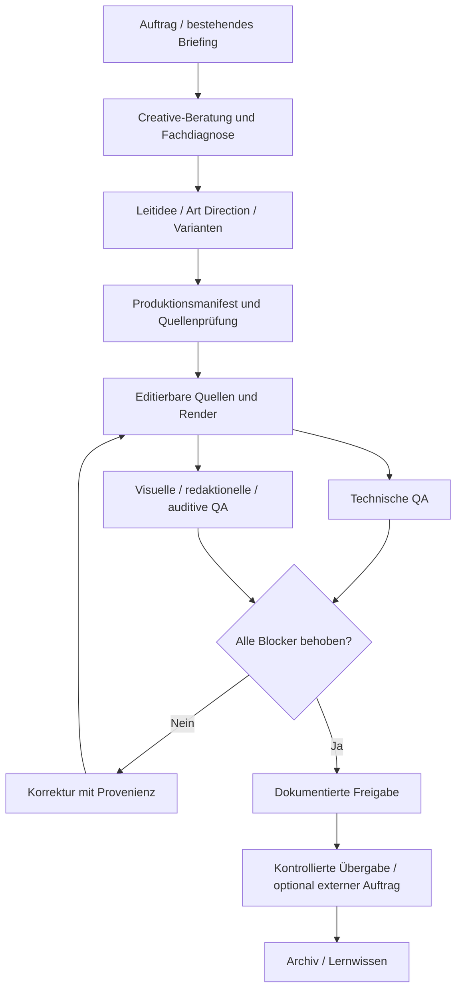

# ABLAUF – durchgehende Qualitätskette

Eine Freigabe nach dem eigentlichen Render hängt an der **konkret geprüften Dateiversion**, nicht an der Entwurfsidee. Externe Aktionen benötigen gesonderte Autorisierung.
